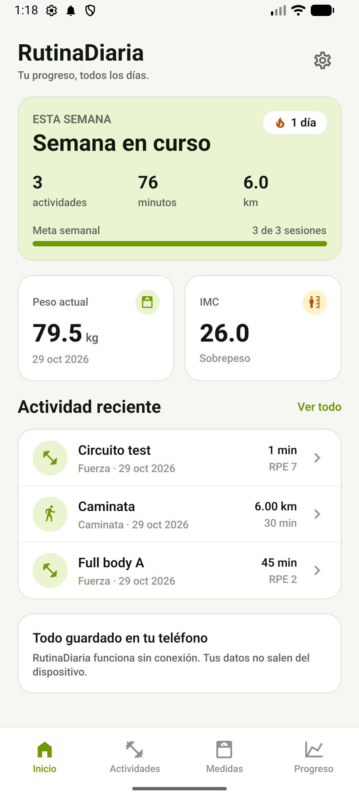
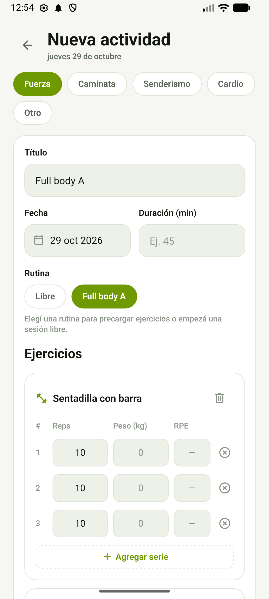
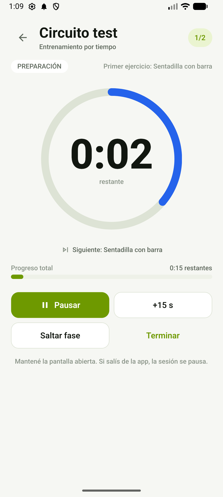
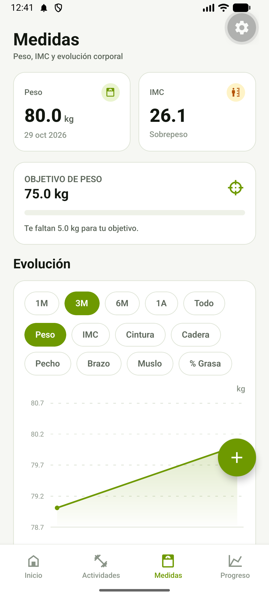
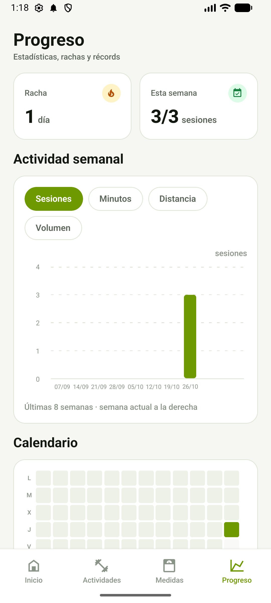
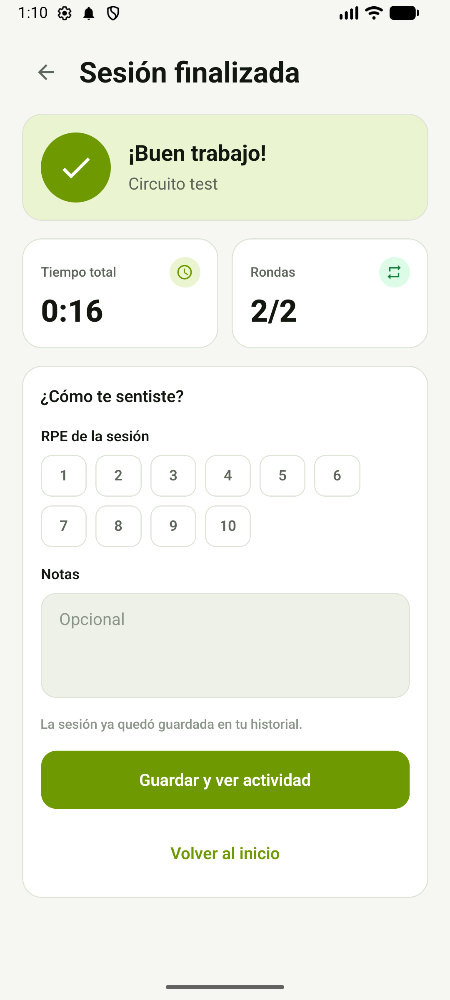

# RutinaDiaria

App Android para llevar el control de entrenamientos, rutinas, caminatas, senderismo y mediciones corporales, con gráficos de evolución y estadísticas. Funciona **100 % offline** y en español.

<p align="center">
  <a href="https://github.com/MatiasSpacech/RutinaDiaria/releases/download/v1.0.0/RutinaDiaria-v1.0.0.apk">
    
  </a>
</p>



## Funcionalidades

- **Perfil y objetivos:** altura, edad, sexo, nivel de actividad, peso objetivo, meta semanal de sesiones y unidades métricas o imperiales.
- **Actividades:** fuerza con series de reps, peso y RPE; caminatas y senderismo con distancia, desnivel y terreno; cardio y otras actividades.
- **Rutinas reutilizables:** plantillas por series y repeticiones, o **rutinas por tiempo** con rondas, preparación y descansos.
- **Entrenamiento por tiempo:** cronómetro con anillo de progreso, pausa, salto de fase, +15 s, pitidos, vibración, pantalla encendida y guardado automático.
- **Mediciones corporales:** peso, IMC con clasificación OMS, cintura, cadera, pecho, brazo, muslo, % de grasa y notas.
- **Gráficos de evolución:** peso, IMC y medidas seleccionables, con rangos de 1 mes a todo el historial.
- **Inicio:** resumen semanal, racha, meta semanal, último peso/IMC y actividad reciente.
- **Progreso:** estadísticas de 8 semanas, heatmap de 12 semanas, distribución por tipo de actividad y récords personales con 1RM estimado (Epley).
- **Datos:** backup JSON mediante el selector de compartir y opción de borrar todos los datos.
- **Privacidad:** sin cuentas, sin nube y sin conexión; los datos se guardan en SQLite dentro del dispositivo.

## Capturas

| | | |
| --- | --- | --- |
|  |  |  |
| Inicio | Entrenamiento de fuerza | Rutina por tiempo |
|  |  |  |
| Medidas y evolución | Progreso y récords | Resumen del timer |

## Stack

- **Expo SDK 58** con **React Native** y **TypeScript**.
- **expo-router** para navegación por pestañas y rutas apiladas.
- **expo-sqlite** para persistencia local con migraciones.
- **Zustand** para estado global.
- **date-fns** para fechas y agregados.
- **react-native-gifted-charts** y **react-native-svg** para gráficos.
- **expo-audio**, **expo-haptics** y **expo-keep-awake** para el entrenamiento por tiempo.
- **Jest + jest-expo** para tests de lógica.

## Descargar la APK

[Descargar RutinaDiaria v1.0.0 para Android](https://github.com/MatiasSpacech/RutinaDiaria/releases/download/v1.0.0/RutinaDiaria-v1.0.0.apk)

También está disponible en [GitHub Releases](https://github.com/MatiasSpacech/RutinaDiaria/releases/tag/v1.0.0). Es un APK universal firmado con clave de depuración: para instalarlo hay que habilitar la instalación desde orígenes desconocidos. Para publicar en Play Store se necesita una keystore de producción.

## Ejecutar el proyecto

Requisitos: Node.js 20 o superior y Android Studio con un emulador, o la app **Expo Go** en un teléfono.

```bash
npm install
npx expo start
```

Luego:

- escaneá el código QR con Expo Go, o
- presioná `a` para abrir el emulador Android.

### Scripts

```bash
npm run typecheck   # TypeScript sin errores
npm run lint        # ESLint (expo lint)
npm test            # tests de dominio y del motor de timer
```

## Estructura

```
src/app/                 Rutas de expo-router (tabs, actividades, medidas, rutinas, timer)
src/components/          Componentes de UI reutilizables
src/db/                  Cliente SQLite, migraciones, semilla y repositorios
src/domain/              Tipos, cálculos, estadísticas y motor de timer
src/store/               Estado global con Zustand
src/theme/               Tema claro/oscuro y tokens de diseño
src/utils/               Fechas, números y utilidades
docs/screenshots/        Capturas para la documentación
PLAN.md                  Plan de producto y arquitectura
TODO.md                  Checklist de implementación por fases
```

## Modelo de datos

Tablas locales: `profile`, `exercises`, `routines`, `routine_exercises`, `activities`, `strength_sets` y `measurements`. Las migraciones se controlan con `PRAGMA user_version` y la biblioteca de ejercicios se carga la primera vez.

## Próximas ideas

- GPS y rutas con mapa para caminatas y senderismo.
- Fotos de progreso.
- Recordatorios locales y notificaciones con la pantalla bloqueada.
- Importación de backups, exportación CSV.
- Integración con Google Fit / Health Connect.
- Build de producción y publicación en Play Store.

## Estado

Versión **1.0.0** — funcionalidades principales implementadas y verificadas en emulador Android. Repositorio: [MatiasSpacech/RutinaDiaria](https://github.com/MatiasSpacech/RutinaDiaria).
